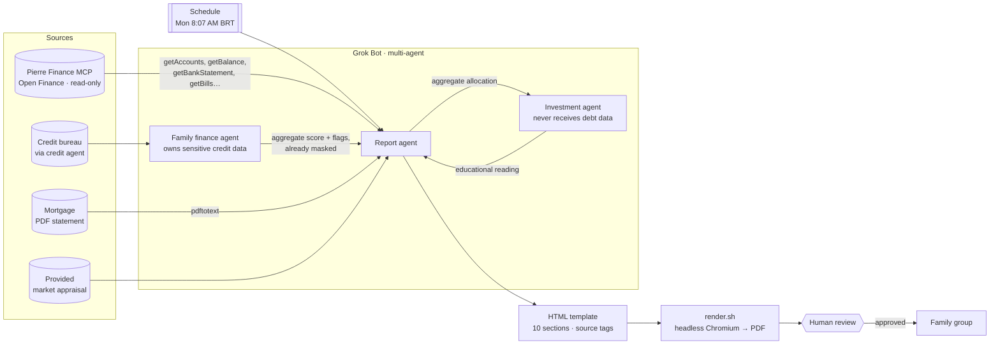

🇧🇷 [Português](README.md) | 🇺🇸 **English**

# Weekly family finance report with AI + Open Finance

> An AI product case: replacing a paid wealth-management app with an automated weekly report, built by an AI assistant (Grok Bot) connected to Open Finance data — with privacy, source traceability, and a human in the loop.

**Autor/Author:** Renan R. Rosa — Staff Product Manager | Payment Infrastructure | Pix · Open Finance · BaaS · AI · [LinkedIn](https://www.linkedin.com/in/renanrrosa)
**Status:** documented case · template and example with **100% fictitious data** (Silva Family, Bank A/B/C).

<p align="center"></p>

> The report itself (template, tags, and labels) is in Brazilian Portuguese. This English version documents the case; literal values that appear in the report — such as the `AVALIAÇÃO` tag or the “a conectar” (“to be connected”) placeholder — are kept as-is.

---

## 1. Problem

The family used a paid wealth-management app (~**R$ 200/month**) to consolidate accounts, credit cards, investments, and debts. In practice:

- **High recurring cost** for what was essentially a weekly read.
- **Incomplete picture:** the app didn't cover every bank, couldn't read the mortgage statement, and had no credit score.
- **No context:** raw numbers, with no explanation of discrepancies and no suggested next step.
- **Source being discontinued:** the service was no longer a long-term option.

**Product question:** can we get a *better* report — more complete, explainable, and trustworthy — using an AI assistant and the Open Finance APIs that already exist?

## 2. Solution

An **automated weekly routine** (Mondays, 8:07 AM BRT) in which the assistant:

1. Reads accounts, balances, statements, card bills, and installments through the **Pierre Finance MCP** (an Open Finance aggregator), using **read-only tools only**.
2. Adds sources that Open Finance doesn't cover: **credit score** (via a separate agent), the **mortgage PDF statement** (via `pdftotext`), and the **property's market value** (an appraisal provided by the family).
3. Fills a 6-page, 10-section **HTML template**, with a source tag on every number.
4. Renders it to **PDF** and delivers a short summary for human review before it is shared in the family group.

## 3. Architecture



Architecture principles:

- **Read-only by default.** The Open Finance integration only reads; no tool that changes data is part of the routine.
- **Separation by sensitivity.** Credit data stays with a dedicated agent; the investment agent never sees debts.
- **Deterministic template.** The model decides *what* to say; the layout is fixed and versioned.

## 4. Results

| Dimension | Before (paid app) | After (assistant + Open Finance) |
|---|---|---|
| Monthly cost | ~R$ 200 | cost of the existing assistant + aggregator |
| Coverage | some banks | all connected banks + mortgage + score + property |
| Explainability | raw numbers | every value with a source tag and explicit discrepancies |
| Action | none | attention points with traffic light and suggested action |
| Cadence | on demand | automatic, every Monday at 8:07 AM |
| Family's time | open the app, navigate | read one 6-page PDF (≈ 5 min) |

## 5. Lessons learned

1. **Sources disagree — show it, don't hide it.** A historical snapshot and Open Finance rarely match (cut-off dates, uncovered accounts, card vs. account). The report shows both readings side by side in a “sources disagree” block instead of silently picking one.
2. **Masking is a product requirement, not a detail.** Tax IDs (CPF) always as `***.***.***-XX`, accounts and cards with the last 4 digits only, no addresses. This applies to the PDF, the chat, and the logs.
3. **Human in the loop.** The assistant prepares; the family approves before anything is shared. Nothing is sent, paid, or moved automatically.
4. **Never make up numbers.** Missing data shows up as **“a conectar”** (“to be connected”), with a visual placeholder. One plausible but wrong number destroys trust in the whole report.
5. **Source tags on everything.** `PIERRE`, `BUREAU`, `BANCO`, `AVALIAÇÃO`, `HIST` — readers know where each value came from and how fresh it is.
6. **Multi-agent by data sensitivity** reduces the blast radius: each agent receives only the minimum it needs.

## 6. Next steps

- [ ] Time series: week-over-week evolution of net worth.
- [ ] Split the template into data (JSON) + layout (Jinja) for 100% deterministic filling.
- [ ] Connect the institutions still shown as “a conectar”.
- [ ] Family goals (emergency fund, debt payoff) with progress in the report.
- [ ] Automated tests: PII grep on the final PDF before delivery.

## Repository structure

```
docs/en/01-connections.md          Data sources and how to connect the MCP
docs/en/02-routine.md              Weekly routine, prompt, and multi-agent split
docs/en/03-visual.md               Visual language (theme, components, traffic light)
docs/en/04-sections.md             The report's 10 sections
docs/en/05-privacy.md              Masking and sharing rules
docs/en/06-how-to-replicate.md     Step by step
template/                          HTML template (fictitious data)
scripts/render.sh                  HTML → PDF (+ PNG of page 1)
examples/                          PDF and preview generated from the template
prompts/en/weekly-routine.md       Generic routine prompt
```

Portuguese originals: [`docs/`](docs/) and [`prompts/rotina-semanal.md`](prompts/rotina-semanal.md).

## Disclaimer

Personal, educational project, not affiliated with any employer or with the vendors mentioned. All data in this repository is fictitious. Nothing here is financial, credit, or investment advice. [MIT](LICENSE) license.
