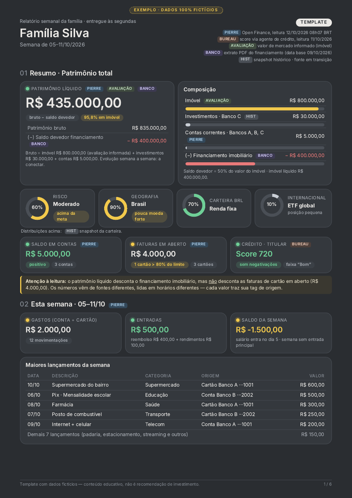
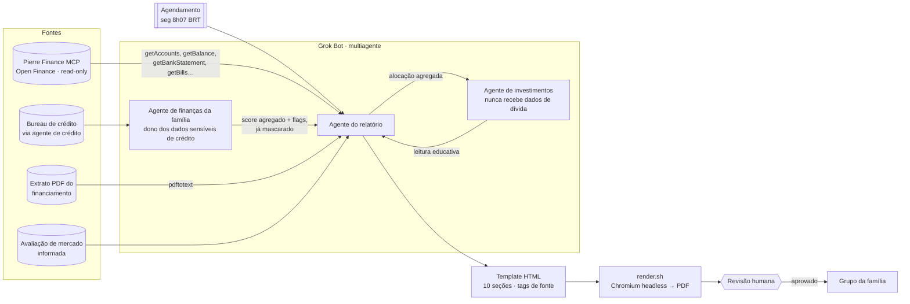

🇧🇷 **Português** | 🇺🇸 [English](README.en.md)

# Relatório financeiro semanal da família com IA + Open Finance

> Um case de produto de IA: como substituir um app pago de gestão patrimonial por um relatório semanal automatizado, montado por um assistente de IA (Grok Bot) conectado a dados de Open Finance — com privacidade, rastreabilidade de fonte e humano no circuito.

**Autor/Author:** Renan R. Rosa — Staff Product Manager | Payment Infrastructure | Pix · Open Finance · BaaS · AI · [LinkedIn](https://www.linkedin.com/in/renanrrosa)
**Status:** case documentado · template e exemplo com **dados 100% fictícios** (Família Silva, Banco A/B/C).

<p align="center"></p>

---

## 1. Problema

A família usava um app pago de gestão patrimonial (~**R$ 200/mês**) para consolidar contas, cartões, investimentos e dívidas. Na prática:

- **Custo recorrente alto** para o que era, essencialmente, uma leitura semanal.
- **Visão incompleta:** o app não cobria todos os bancos, não lia o extrato do financiamento imobiliário e não trazia score de crédito.
- **Sem contexto:** números soltos, sem explicar divergências nem sugerir o próximo passo.
- **Fonte em descontinuação:** o serviço deixou de ser uma opção de longo prazo.

**Pergunta de produto:** dá para ter um relatório *melhor* — mais completo, explicável e confiável — usando um assistente de IA e as APIs de Open Finance que já existem?

## 2. Solução

Uma **rotina semanal automatizada** (segundas, 8h07 BRT) em que o assistente:

1. Lê contas, saldos, extratos, faturas e parcelamentos via **MCP da Pierre Finance** (agregador de Open Finance), usando **apenas ferramentas de leitura**.
2. Complementa com fontes que o Open Finance não cobre: **score de crédito** (via um agente separado), **extrato PDF do financiamento** (via `pdftotext`) e **valor de mercado do imóvel** (avaliação informada pela família).
3. Preenche um **template HTML** de 6 páginas e 10 seções, com tags de fonte em cada número.
4. Renderiza em **PDF** e entrega um resumo curto para revisão humana antes de compartilhar no grupo da família.

## 3. Arquitetura



Princípios de arquitetura:

- **Read-only por padrão.** A integração de Open Finance só lê; nenhuma ferramenta que altera dados entra na rotina.
- **Separação por sensibilidade.** Dados de crédito ficam com um agente dedicado; o agente de investimentos nunca vê dívidas.
- **Template determinístico.** O modelo decide *o que* dizer; o layout é fixo e versionado.

## 4. Resultados

| Dimensão | Antes (app pago) | Depois (assistente + Open Finance) |
|---|---|---|
| Custo mensal | ~R$ 200 | custo do assistente já existente + agregador |
| Cobertura | parte dos bancos | todos os bancos conectados + financiamento + score + imóvel |
| Explicabilidade | números soltos | cada valor com tag de fonte e divergências explícitas |
| Ação | nenhuma | pontos de atenção com semáforo e ação sugerida |
| Cadência | sob demanda | automática, toda segunda 8h07 |
| Tempo da família | abrir app, navegar | ler 1 PDF de 6 páginas (≈ 5 min) |

## 5. Lições aprendidas

1. **Fontes divergem — mostre, não esconda.** Snapshot histórico e Open Finance raramente batem (datas de corte, contas não cobertas, cartão vs. conta). O relatório exibe as duas leituras lado a lado com um bloco “fontes divergem”, em vez de escolher uma em silêncio.
2. **Mascaramento é requisito de produto, não detalhe.** CPF sempre `***.***.***-XX`, contas e cartões só com os 4 últimos dígitos, nenhum endereço. Isso vale para o PDF, para o chat e para os logs.
3. **Humano no circuito.** O assistente prepara; a família aprova antes de qualquer compartilhamento. Nada é enviado, pago ou movimentado automaticamente.
4. **Nunca inventar números.** Dado ausente aparece como **“a conectar”**, com placeholder visual. Um número plausível e errado destrói a confiança no relatório inteiro.
5. **Tags de fonte em tudo.** `PIERRE`, `BUREAU`, `BANCO`, `AVALIAÇÃO`, `HIST` — o leitor sabe de onde veio cada valor e quão fresco ele é.
6. **Multiagente por sensibilidade de dado** reduz o raio de exposição: cada agente só recebe o mínimo necessário.

## 6. Próximos passos

- [ ] Série histórica: evolução semana a semana do patrimônio líquido.
- [ ] Separar o template em dados (JSON) + layout (Jinja) para preenchimento 100% determinístico.
- [ ] Conectar as instituições que ainda aparecem como “a conectar”.
- [ ] Metas da família (reserva, quitação) com progresso no relatório.
- [ ] Testes automáticos: grep de PII no PDF final antes da entrega.

## Estrutura do repositório

```
docs/01-conexoes.md       Fontes de dados e como conectar o MCP
docs/02-rotina.md         Rotina semanal, prompt e divisão multiagente
docs/03-visual.md         Linguagem visual (tema, componentes, semáforo)
docs/04-secoes.md         As 10 seções do relatório
docs/05-privacidade.md    Regras de mascaramento e compartilhamento
docs/06-como-replicar.md  Passo a passo
template/                 Template HTML (dados fictícios)
scripts/render.sh         HTML → PDF (+ PNG da página 1)
examples/                 PDF e preview gerados do template
prompts/rotina-semanal.md Prompt genérico da rotina
```

## Aviso

Projeto pessoal e educativo, sem vínculo com empregadores ou com os fornecedores citados. Todos os dados do repositório são fictícios. Nada aqui é recomendação financeira, de crédito ou de investimento. Licença [MIT](LICENSE).
