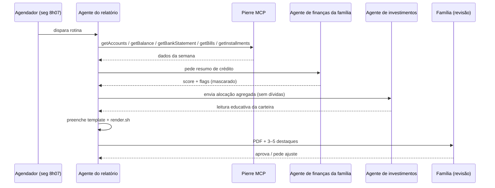

🇧🇷 **Português** | 🇺🇸 [English](en/02-routine.md)

# 02 · Rotina semanal

## Agenda

- **Quando:** toda **segunda-feira, 8h07 (BRT, UTC-3)**.
  O minuto “quebrado” evita a disputa de horário cheio em agendadores e deixa claro que é uma rotina automática.
- **Período coberto:** semana anterior, segunda a domingo; fluxo de caixa do mês corrente até domingo.
- **Entrega:** PDF + resumo de 3–5 destaques no chat, para **revisão humana** antes de ir ao grupo da família.

## O prompt da rotina (versão genérica)

O prompt completo está em [`prompts/rotina-semanal.md`](../prompts/rotina-semanal.md). Em resumo:

1. Coletar dados só com ferramentas de leitura.
2. Pedir ao agente de crédito o resumo agregado e mascarado.
3. Ler o extrato do financiamento com `pdftotext`.
4. Preencher o template, com tag de fonte em todo número e “a conectar” onde faltar dado.
5. Renderizar, verificar PII e entregar para revisão.

## Divisão multiagente

O sistema usa três agentes com **escopos de dados diferentes**. A regra é: cada agente recebe o mínimo necessário.

| Agente | Responsabilidade | Vê | Não vê |
|---|---|---|---|
| **Agente do relatório** | Orquestra a rotina, monta e renderiza o PDF | Open Finance (read-only), extrato do financiamento, avaliação do imóvel, **resumo** de crédito | Dados brutos do bureau (contratos, credores, consultas detalhadas) |
| **Agente de finanças da família** | Dono dos dados sensíveis de crédito; acompanha score, restrições e negociações | Bureau de crédito completo | — (é o único com acesso) |
| **Agente de investimentos** | Leitura educativa da carteira e alocação | Alocação agregada (classes, geografia, %) | **Nunca recebe dados de dívida**, score ou restrições |

### Por que separar?

- **Raio de exposição menor:** um prompt mal formulado no agente de investimentos não tem como vazar dívidas, porque ele nunca as recebeu.
- **Viés:** análise de carteira não deve ser contaminada por pressão de dívida — e vice-versa; quem decide prioridades é a família.
- **Auditoria:** fica claro qual agente tocou em qual dado.

## Guardrails da rotina

- Nada é publicado, enviado por e-mail, pago ou movimentado sem aprovação explícita.
- Falha numa fonte não bloqueia o relatório: a seção mostra “a conectar” e o motivo.
- Análises de carteira são **educativas**, nunca recomendação de investimento.
