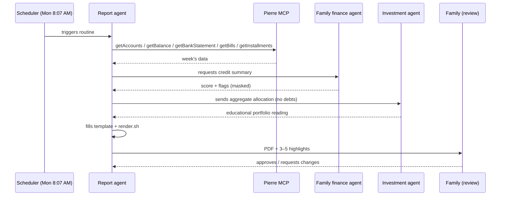

🇧🇷 [Português](../02-rotina.md) | 🇺🇸 **English**

# 02 · Weekly routine

## Schedule

- **When:** every **Monday at 8:07 AM (BRT, UTC-3)**.
  The “odd” minute avoids top-of-the-hour contention in schedulers and makes it clear this is an automated routine.
- **Period covered:** the previous week, Monday to Sunday; cash flow for the current month through Sunday.
- **Delivery:** PDF + a 3–5 highlight summary in the chat, for **human review** before it goes to the family group.

## The routine prompt (generic version)

The full prompt is in [`prompts/en/weekly-routine.md`](../../prompts/en/weekly-routine.md). In short:

1. Collect data using read-only tools only.
2. Ask the credit agent for the aggregated, masked summary.
3. Read the mortgage statement with `pdftotext`.
4. Fill the template, with a source tag on every number and “a conectar” (“to be connected”) wherever data is missing.
5. Render, check for PII, and deliver for review.

## Multi-agent split

The system uses three agents with **different data scopes**. The rule: each agent receives the minimum it needs.

| Agent | Responsibility | Sees | Doesn't see |
|---|---|---|---|
| **Report agent** | Orchestrates the routine, builds and renders the PDF | Open Finance (read-only), mortgage statement, property appraisal, credit **summary** | Raw bureau data (contracts, creditors, detailed inquiries) |
| **Family finance agent** | Owns the sensitive credit data; tracks score, negative records, and negotiations | Full credit bureau data | — (the only one with access) |
| **Investment agent** | Educational reading of the portfolio and allocation | Aggregate allocation (asset classes, geography, %) | **Never receives debt data**, score, or negative records |

### Why separate?

- **Smaller blast radius:** a poorly worded prompt to the investment agent cannot leak debts, because it never received them.
- **Bias:** portfolio analysis shouldn't be skewed by debt pressure — and vice versa; the family decides priorities.
- **Auditability:** it is clear which agent touched which data.

## Routine guardrails

- Nothing is published, emailed, paid, or moved without explicit approval.
- A failure in one source doesn't block the report: the section shows “a conectar” and the reason.
- Portfolio analyses are **educational**, never investment advice.
